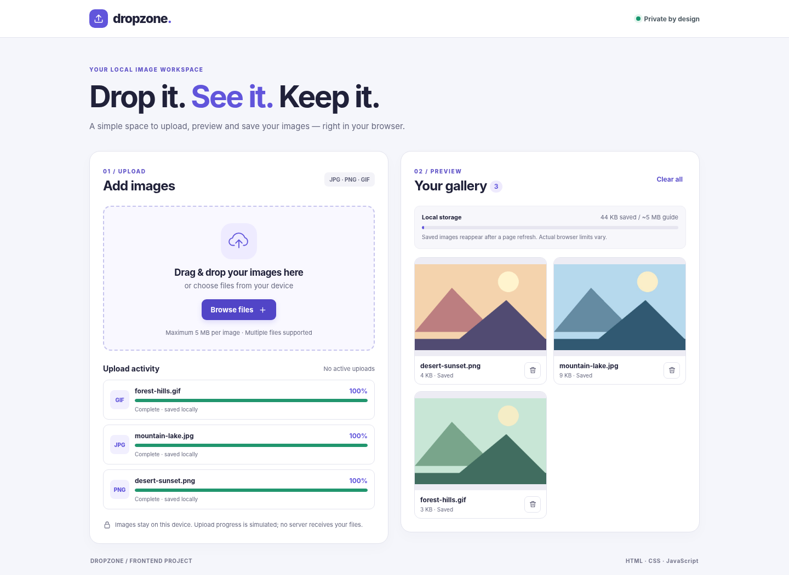

# Dropzone — Drag-and-Drop Image Uploader

A responsive, client-side image uploader built with HTML5, CSS3 and vanilla JavaScript. Drop images or browse files, watch a simulated upload progress bar, preview images and keep them in a local gallery after refreshing the page.



[Mobile preview](docs/mobile-preview.png)

## Features

- Drag and drop one or more images into the highlighted drop zone.
- Browse files using the native HTML file picker (also works with keyboard and touch).
- Accept JPG/JPEG, PNG and GIF. Validate extension, MIME type, file signature and image readability.
- Show clear errors for unsupported, empty, damaged or oversized files.
- Simulate upload progress from 0 to 100% with recursive `setTimeout()` calls.
- Read image data with `FileReader.readAsDataURL()` and show thumbnails and a full-size preview.
- Store completed images using `localStorage` and restore the gallery on page load.
- Remove individual images or clear the entire gallery with confirmation.
- Display storage usage estimates and handle full or unavailable storage gracefully.
- Responsive layout, accessible buttons and reduced-motion support.

## Run locally

No package installation, API key, backend or database is required for the app.

1. Extract the ZIP or clone your repository.
2. Open the `image-uploader` project folder in VS Code.
3. Open `index.html` with the Live Server extension, or run the command below from the project directory.

```bash
python -m http.server 8000
```

Visit `http://localhost:8000` in your browser. You may also open `index.html` directly, but browser behavior for `localStorage` on `file://` URLs varies; localhost or GitHub Pages is recommended for persistence.

## How it works

1. File input `change` or drag-and-drop `drop` events provide a list of File objects.
2. Validation checks the allowed type, size and signature. A `FileReader` reads the file as a Base64 data URL, and the browser confirms the image can be decoded.
3. A `setTimeout` loop updates a progress bar and its accessible percentage in 10% increments.
4. The app creates preview elements using DOM methods and stores the image metadata and data URL in `localStorage`.
5. On startup, saved gallery entries are parsed and restored. Removing an image updates the stored gallery.

## Technical notes

- This is an upload **simulation**, not a server-side file upload. Images are not transmitted anywhere.
- Maximum accepted file size: 5 MiB per image. Browser storage quotas vary and Base64 increases storage requirements; even a valid image may be too large to persist. When a save fails, the app explicitly marks that preview as session-only. The storage meter is an estimate, not a measurement of the browser's total remaining quota.
- Persistence is local to the browser and origin; private browsing, clearing site data, or browser storage policies may affect it.
- The gallery shows only the user's own selected images; sample images appear only in documentation screenshots.

## Project structure

```text
image-uploader/
├── index.html             # HTML structure
├── style.css              # Layout and responsive styling
├── script.js              # Validation, preview, progress and storage
├── assets/favicon.svg
├── docs/desktop-preview.png
├── docs/mobile-preview.png
├── tests/browser_test.py  # Optional integration tests
├── .gitignore
├── .nojekyll
└── README.md
```

## Publish on GitHub Desktop

1. Extract the archive. Select the inner `image-uploader` folder containing `index.html`.
2. Open GitHub Desktop and choose **File → Add local repository → Choose**.
3. Select that folder. If GitHub Desktop says it is not a repository, click **create a repository** in the message.
4. Set name to `image-uploader`, add a description, choose None for Git Ignore and License, and leave Initialize with README unchecked (the project includes both README and .gitignore). Confirm the repository folder points to the project files, not a new empty subfolder.
5. Click **Create Repository**. Inspect the initial commit under History, verifying the project files are included. If there are uncommitted files, enter `Add complete image uploader project` in Summary and select **Commit to main**.
6. Click **Publish repository**. Uncheck **Keep this code private** if the internship evaluator needs public access. Click **Publish Repository** again.
7. Choose **Repository → View on GitHub**. Check that `index.html`, `style.css`, `script.js` and `README.md` are visible at the root. Copy the URL for submission.

Optional live demo: open the GitHub repository's **Settings → Pages**, choose **Deploy from a branch**, select `main` and `/ (root)`, then Save. Use the URL GitHub provides after deployment. A live demo is not required by the supplied feature list; follow any separate internship submission rules.

## Optional browser tests

The app itself has no dependencies. The tests require Python, Playwright and Pillow:

```bash
python -m pip install playwright pillow
python -m playwright install chromium
python tests/browser_test.py
```

Tests cover native file selection, multiple files, drag/drop events, all three image formats, progress, preview, restoration, invalid files, removal, clear confirmation, storage errors, responsive widths and browser JavaScript exceptions.

In a restricted environment, set `OFFLINE_TEST=1` and optionally `CHROMIUM_PATH` to an existing Chromium executable. This mode renders the actual app HTML/CSS/JS inline and simulates storage across page recreation. It does not verify native browser persistence across a real navigation. This offline mode passed during development; actual localhost navigation was blocked by the environment policy. The default test mode uses a local server and real browser storage.
